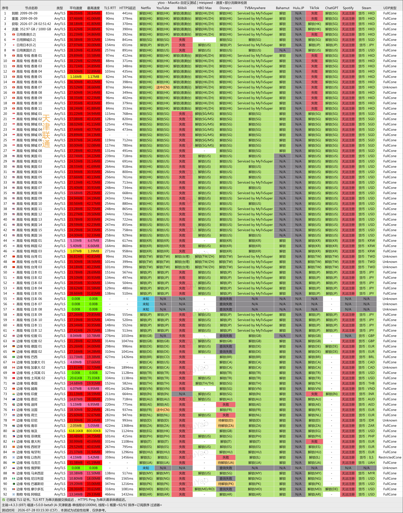
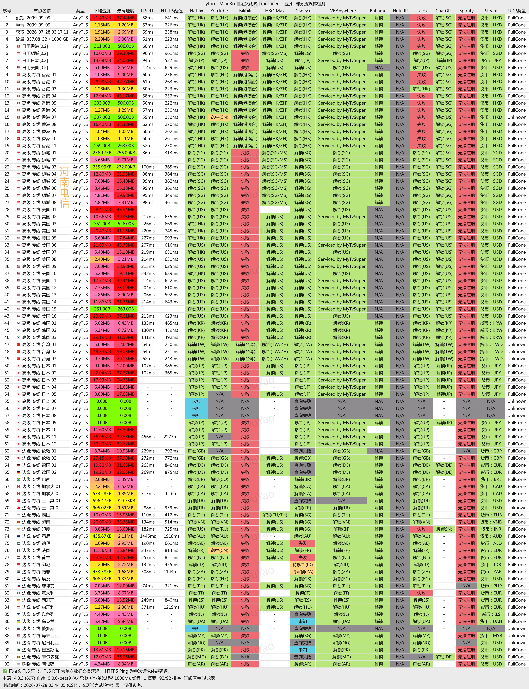
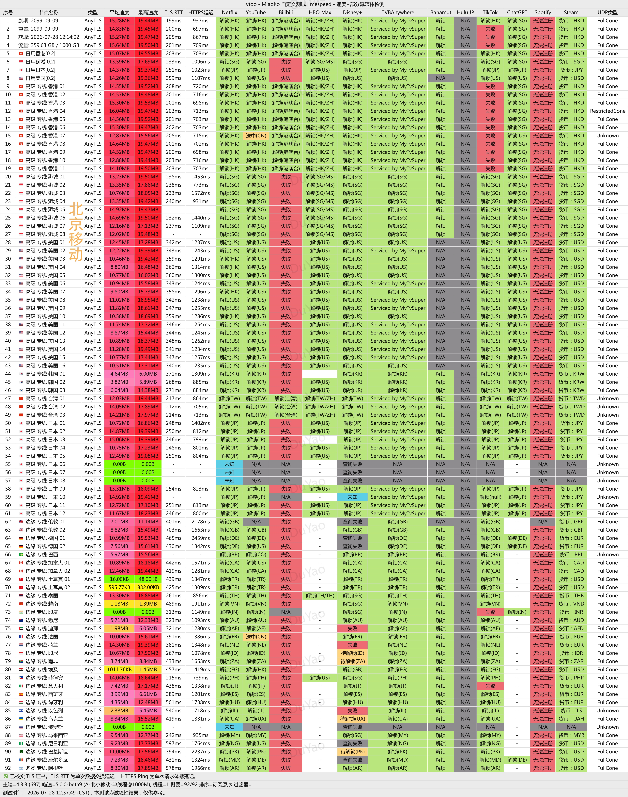
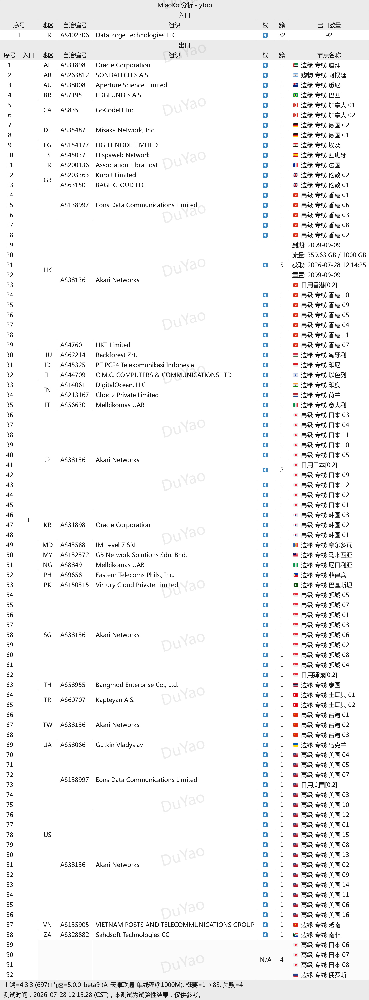

🇨🇳 [中文](README.md) | 🇺🇸 English | 🇷🇺 [Русский](README_RU.md) | 🇮🇷 [فارسی](README_FA.md)

# YtooVPN Dedicated-Line VPN Official Website (Updated November 9, 2026)

Official YtooVPN Website<br>
Official URL: [y-too.net](https://to.iix.im/yt01)<br>

Best VPN Recommendations and Server List for 2026: [https://github.com/jdnei/JiChangTuiJian](https://github.com/jdnei/JiChangTuiJian)<br>

## Telegram VPN Deals & Community #AD
[VPN Giveaways](https://331024.de/archives/choujiang) | [VPN Chat Group](https://331024.de/archives/choujiang) | [VPN Trial Group](https://331024.de/archives/choujiang)<br>

[https://331024.de/archives/choujiang](https://331024.de/archives/choujiang)

## Promo Code / Discount Code
`15% OFF | Expires October 31 (Year Not Specified) | Excludes Air / Team Plans`

```bash
MV3M88XZM
```

## Overview
YtooVPN, also known as YToo, is a network acceleration service provider specializing in IEPL dedicated-line connections.

The service offers servers across multiple regions and is suitable for video streaming, AI tools, and international internet access.

## Advantages
YToo uses IEPL dedicated lines and BGP optimization with three network entry points to deliver stable connections, relatively low latency, and consistent performance during evening peak hours.

The service supports Netflix streaming and access to ChatGPT, while also offering servers with reduced traffic multipliers to improve data efficiency.

By balancing connection speed, data usage efficiency, and multi-device requirements, YToo is particularly suitable for users who prioritize network stability and reliable international connectivity.

## Pricing Plans

| Category | Plan | Price | Monthly Data | Network & Exit Locations | Unblocking Services | Maximum Speed | Usage Restrictions | IP Limit | Technical Support |
| --- | --- | ---: | ---: | --- | --- | ---: | --- | ---: | --- |
| Global Accelerate | Air | ¥98.00/year | 15 GB | Multi-route optimization in mainland China; international dedicated-line transmission; exit servers in popular overseas countries and regions | Multiple streaming services, ChatGPT | 1000 Mbps | Account holder only | 3 IPs | Standard Support |
| Global Accelerate | Basic | ¥36.00/month | 200 GB | Multi-route optimization in mainland China; international dedicated-line transmission; exit servers in popular overseas countries and regions | Multiple streaming services, ChatGPT | 1000 Mbps | Account holder only | 4 IPs | Standard Support |
| Global Accelerate | Plus | ¥54.00/month | 400 GB | Multi-route optimization in mainland China; international dedicated-line transmission; exit servers in popular overseas countries and regions | Multiple streaming services, ChatGPT | 1000 Mbps | Account holder only | 4 IPs | Standard Support |
| Global Accelerate | Pro | ¥108.00/month | 1000 GB | Multi-route optimization in mainland China; international dedicated-line transmission; exit servers in popular overseas countries and regions | Multiple streaming services, ChatGPT | 1000 Mbps | Account holder only | 5 IPs | Standard Support |
| Global Accelerate Team | Team Lite | ¥499.00/month | 3000 GiB | Multi-route optimization in mainland China; international dedicated-line transmission; exit servers in popular overseas countries and regions | Multiple streaming services, ChatGPT | 2000 Mbps | Team members only | 20 IPs | Advanced Support |
| Global Accelerate Team | Team Pro | ¥899.00/month | 5000 GiB | Multi-route optimization in mainland China; international dedicated-line transmission; exit servers in popular overseas countries and regions | Multiple streaming services, ChatGPT | 2000 Mbps | Team members only | 30 IPs | Advanced Support |

## 📊 Performance Tests & Analysis

#### 1. China Unicom Evening Peak-Hour Speed Test & Streaming Unblocking Report


#### 2. China Telecom Evening Peak-Hour Speed Test & Streaming Unblocking Report


#### 3. China Mobile Evening Peak-Hour Speed Test & Streaming Unblocking Report


#### 4. Entry and Exit Node Analysis

