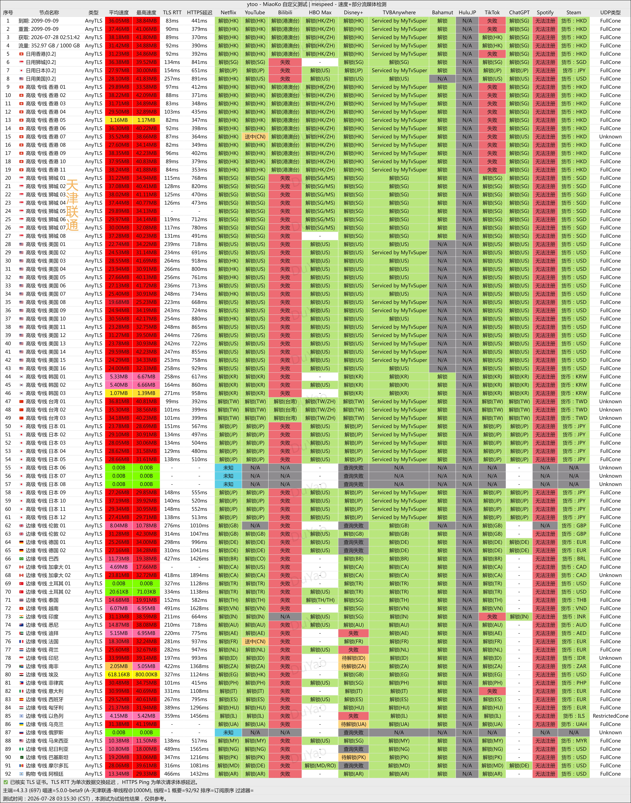
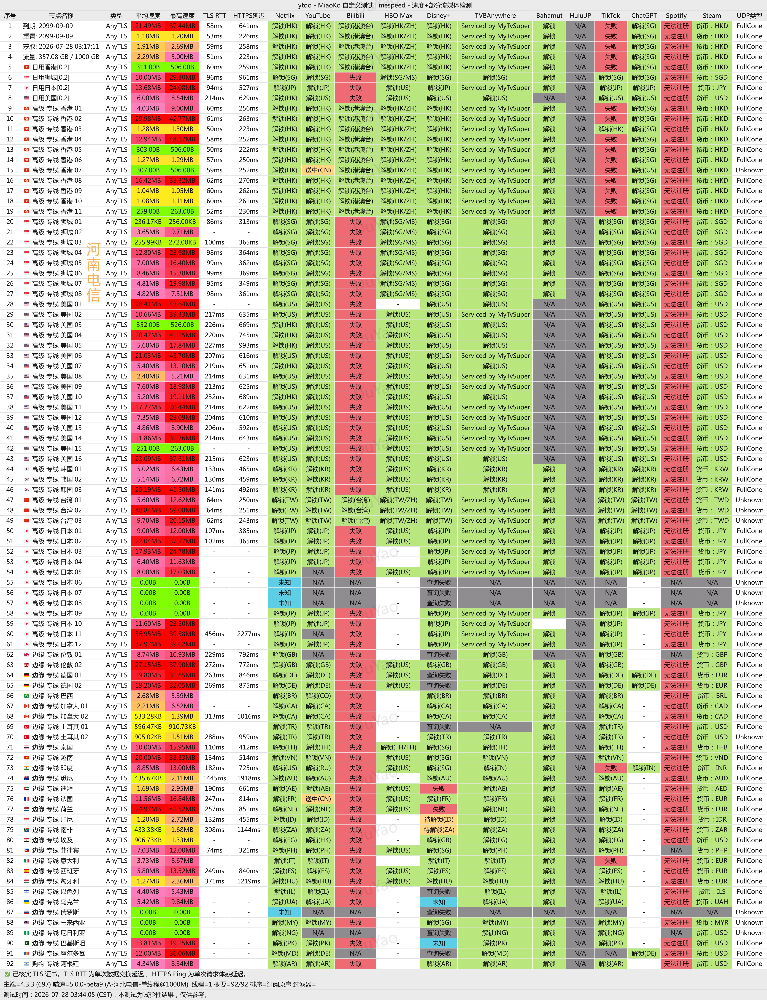
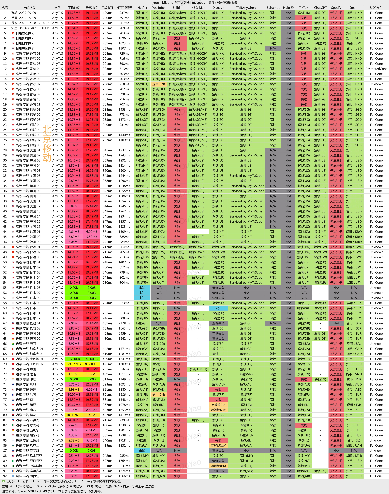
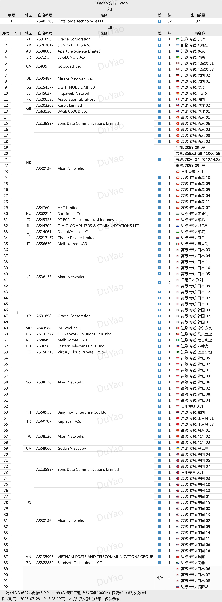

 🇨🇳 [中文](README.md) | 🇺🇸 [English](README_EN.md) | 🇷🇺 [Русский](README_RU.md) | 🇮🇷 فارسی

# وب‌سایت رسمی YtooVPN با خطوط اختصاصی(به‌روزرسانی 9 نوامبر 2026)
وب‌سایت رسمی YtooVPN<br>
آدرس رسمی: [y-too.net](https://to.iix.im/yt01)<br>

معرفی بهترین سرویس‌ها و سرورهای VPN در سال ۲۰۲۶: [https://github.com/jdnei/JiChangTuiJian](https://github.com/jdnei/JiChangTuiJian)<br>

## انجمن و پیشنهادهای ویژه VPN در تلگرام #AD
[قرعه‌کشی VPN](https://331024.de/archives/choujiang) | [گروه گفت‌وگوی VPN](https://331024.de/archives/choujiang) | [گروه آزمایش VPN](https://331024.de/archives/choujiang)<br>

[https://331024.de/archives/choujiang](https://331024.de/archives/choujiang)

## کد تخفیف
`۱۵٪ تخفیف | پایان اعتبار: ۳۱ اکتبر (سال مشخص نشده است) | شامل طرح‌های Air و Team نمی‌شود`

```bash
MV3M88XZM
```

## معرفی
YtooVPN که با نام YToo نیز شناخته می‌شود، یک ارائه‌دهنده خدمات افزایش سرعت شبکه است که بر اتصالات خطوط اختصاصی IEPL تمرکز دارد.

این سرویس سرورهایی در مناطق مختلف ارائه می‌کند و برای تماشای ویدئوهای آنلاین، استفاده از ابزارهای هوش مصنوعی و دسترسی بین‌المللی به اینترنت مناسب است.

## مزایا
YToo از خطوط اختصاصی IEPL و بهینه‌سازی BGP با سه نقطه ورودی شبکه استفاده می‌کند تا اتصالات پایدار، تأخیر نسبتاً پایین و عملکرد یکنواخت در ساعات اوج مصرف شبانه را فراهم سازد.

این سرویس از پخش آنلاین Netflix و دسترسی به ChatGPT پشتیبانی می‌کند و همچنین سرورهایی با ضریب محاسبه ترافیک پایین‌تر ارائه می‌دهد تا مصرف حجم اینترنت بهینه‌تر شود.

YToo با ایجاد تعادل میان سرعت اتصال، بهره‌وری مصرف ترافیک و نیازهای استفاده از چندین دستگاه، به‌ویژه برای کاربرانی مناسب است که پایداری شبکه و دسترسی مطمئن به اینترنت بین‌المللی را در اولویت قرار می‌دهند.

## طرح‌های اشتراک

| دسته‌بندی | طرح | قیمت | حجم ماهانه | شبکه و مکان سرورهای خروجی | سرویس‌های قابل دسترسی | حداکثر سرعت | محدودیت استفاده | محدودیت IP | پشتیبانی فنی |
| --- | --- | ---: | ---: | --- | --- | ---: | --- | ---: | --- |
| Global Accelerate | Air | ¥98.00/سال | 15 GB | بهینه‌سازی چندمسیره در سرزمین اصلی چین؛ انتقال از طریق خطوط اختصاصی بین‌المللی؛ سرورهای خروجی در کشورها و مناطق محبوب خارج از کشور | سرویس‌های مختلف پخش آنلاین، ChatGPT | 1000 Mbps | فقط صاحب حساب مجاز به استفاده است | 3 IP | پشتیبانی استاندارد |
| Global Accelerate | Basic | ¥36.00/ماه | 200 GB | بهینه‌سازی چندمسیره در سرزمین اصلی چین؛ انتقال از طریق خطوط اختصاصی بین‌المللی؛ سرورهای خروجی در کشورها و مناطق محبوب خارج از کشور | سرویس‌های مختلف پخش آنلاین، ChatGPT | 1000 Mbps | فقط صاحب حساب مجاز به استفاده است | 4 IP | پشتیبانی استاندارد |
| Global Accelerate | Plus | ¥54.00/ماه | 400 GB | بهینه‌سازی چندمسیره در سرزمین اصلی چین؛ انتقال از طریق خطوط اختصاصی بین‌المللی؛ سرورهای خروجی در کشورها و مناطق محبوب خارج از کشور | سرویس‌های مختلف پخش آنلاین، ChatGPT | 1000 Mbps | فقط صاحب حساب مجاز به استفاده است | 4 IP | پشتیبانی استاندارد |
| Global Accelerate | Pro | ¥108.00/ماه | 1000 GB | بهینه‌سازی چندمسیره در سرزمین اصلی چین؛ انتقال از طریق خطوط اختصاصی بین‌المللی؛ سرورهای خروجی در کشورها و مناطق محبوب خارج از کشور | سرویس‌های مختلف پخش آنلاین، ChatGPT | 1000 Mbps | فقط صاحب حساب مجاز به استفاده است | 5 IP | پشتیبانی استاندارد |
| Global Accelerate Team | Team Lite | ¥499.00/ماه | 3000 GiB | بهینه‌سازی چندمسیره در سرزمین اصلی چین؛ انتقال از طریق خطوط اختصاصی بین‌المللی؛ سرورهای خروجی در کشورها و مناطق محبوب خارج از کشور | سرویس‌های مختلف پخش آنلاین، ChatGPT | 2000 Mbps | فقط اعضای تیم مجاز به استفاده هستند | 20 IP | پشتیبانی پیشرفته |
| Global Accelerate Team | Team Pro | ¥899.00/ماه | 5000 GiB | بهینه‌سازی چندمسیره در سرزمین اصلی چین؛ انتقال از طریق خطوط اختصاصی بین‌المللی؛ سرورهای خروجی در کشورها و مناطق محبوب خارج از کشور | سرویس‌های مختلف پخش آنلاین، ChatGPT | 2000 Mbps | فقط اعضای تیم مجاز به استفاده هستند | 30 IP | پشتیبانی پیشرفته |

## 📊 آزمایش عملکرد و تحلیل

#### 1. آزمایش سرعت China Unicom در ساعات اوج مصرف شبانه و گزارش رفع محدودیت استریم


#### 2. آزمایش سرعت China Telecom در ساعات اوج مصرف شبانه و گزارش رفع محدودیت استریم


#### 3. آزمایش سرعت China Mobile در ساعات اوج مصرف شبانه و گزارش رفع محدودیت استریم


#### 4. تحلیل سرورهای ورودی و خروجی

