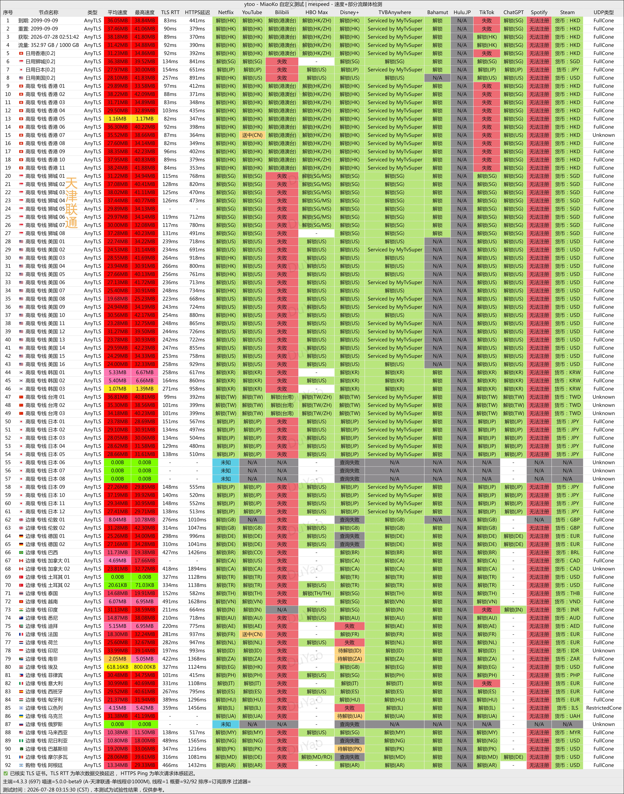
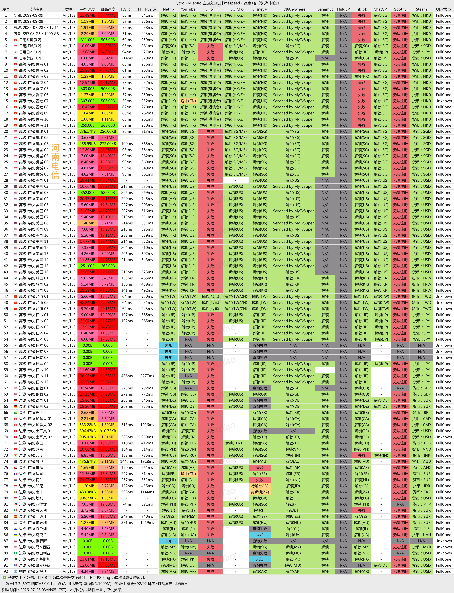
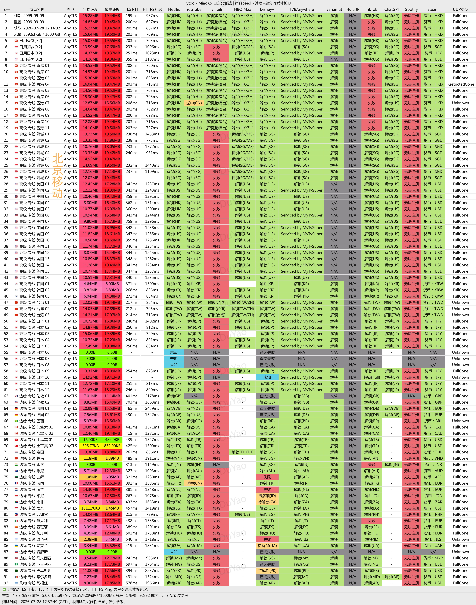
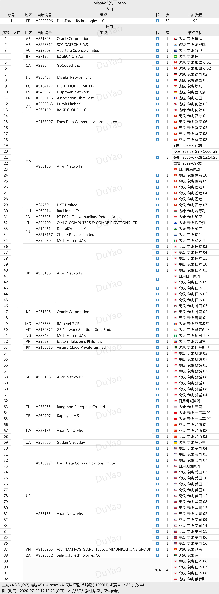

🇨🇳 [中文](README.md) | 🇺🇸 [English](README_EN.md) | 🇷🇺 Русский | 🇮🇷 [فارسی](README_FA.md)

# Официальный сайт YtooVPN с выделенными линиями (обновлено 6 ноября 2026)

Официальный сайт YtooVPN<br>
Официальный адрес: [y-too.net](https://to.iix.im/yt01)<br>

Лучшие VPN-сервисы и серверы на 2026 год: [https://github.com/jdnei/JiChangTuiJian](https://github.com/jdnei/JiChangTuiJian)<br>

## Telegram: VPN-сообщество и специальные предложения #AD
[Розыгрыши VPN](https://331024.de/archives/choujiang) | [Чат о VPN](https://331024.de/archives/choujiang) | [Группа тестирования VPN](https://331024.de/archives/choujiang)<br>

[https://331024.de/archives/choujiang](https://331024.de/archives/choujiang)

## Промокод / Код скидки
`Скидка 15% | Действует до 31 октября (год не указан) | Не распространяется на тарифы Air / Team`

```bash
MV3M88XZM
```

## Обзор
YtooVPN, также известный как YToo, — провайдер услуг ускорения сетевых соединений, специализирующийся на выделенных линиях IEPL.

Сервис предоставляет серверы в различных регионах и подходит для потокового видео, использования инструментов искусственного интеллекта и международного доступа в интернет.

## Преимущества
YToo использует выделенные линии IEPL и оптимизацию BGP с тремя точками входа в сеть, обеспечивая стабильное соединение, относительно низкую задержку и устойчивую работу в вечерние часы пик.

Сервис поддерживает потоковое видео Netflix и доступ к ChatGPT, а также предоставляет серверы с пониженными коэффициентами учёта трафика для более эффективного использования доступного объёма данных.

Благодаря балансу между скоростью соединения, эффективностью расходования трафика и поддержкой нескольких устройств YToo особенно подходит пользователям, которым важны стабильность сети и надёжный международный доступ в интернет.

## Тарифные планы

| Категория | Тариф | Цена | Трафик в месяц | Сеть и расположение выходных серверов | Доступные сервисы | Максимальная скорость | Ограничения использования | Лимит IP | Техническая поддержка |
| --- | --- | ---: | ---: | --- | --- | ---: | --- | ---: | --- |
| Global Accelerate | Air | ¥98.00/год | 15 ГБ | Оптимизация нескольких маршрутов в материковом Китае; международные выделенные линии; выходные серверы в популярных зарубежных странах и регионах | Различные стриминговые сервисы, ChatGPT | 1000 Мбит/с | Только владелец аккаунта | 3 IP | Стандартная поддержка |
| Global Accelerate | Basic | ¥36.00/мес. | 200 ГБ | Оптимизация нескольких маршрутов в материковом Китае; международные выделенные линии; выходные серверы в популярных зарубежных странах и регионах | Различные стриминговые сервисы, ChatGPT | 1000 Мбит/с | Только владелец аккаунта | 4 IP | Стандартная поддержка |
| Global Accelerate | Plus | ¥54.00/мес. | 400 ГБ | Оптимизация нескольких маршрутов в материковом Китае; международные выделенные линии; выходные серверы в популярных зарубежных странах и регионах | Различные стриминговые сервисы, ChatGPT | 1000 Мбит/с | Только владелец аккаунта | 4 IP | Стандартная поддержка |
| Global Accelerate | Pro | ¥108.00/мес. | 1000 ГБ | Оптимизация нескольких маршрутов в материковом Китае; международные выделенные линии; выходные серверы в популярных зарубежных странах и регионах | Различные стриминговые сервисы, ChatGPT | 1000 Мбит/с | Только владелец аккаунта | 5 IP | Стандартная поддержка |
| Global Accelerate Team | Team Lite | ¥499.00/мес. | 3000 GiB | Оптимизация нескольких маршрутов в материковом Китае; международные выделенные линии; выходные серверы в популярных зарубежных странах и регионах | Различные стриминговые сервисы, ChatGPT | 2000 Мбит/с | Только для членов команды | 20 IP | Расширенная поддержка |
| Global Accelerate Team | Team Pro | ¥899.00/мес. | 5000 GiB | Оптимизация нескольких маршрутов в материковом Китае; международные выделенные линии; выходные серверы в популярных зарубежных странах и регионах | Различные стриминговые сервисы, ChatGPT | 2000 Мбит/с | Только для членов команды | 30 IP | Расширенная поддержка |

## 📊 Тесты производительности и анализ

#### 1. Тест скорости China Unicom в вечерние часы пик и отчёт о разблокировке стриминга


#### 2. Тест скорости China Telecom в вечерние часы пик и отчёт о разблокировке стриминга


#### 3. Тест скорости China Mobile в вечерние часы пик и отчёт о разблокировке стриминга


#### 4. Анализ входных и выходных узлов

